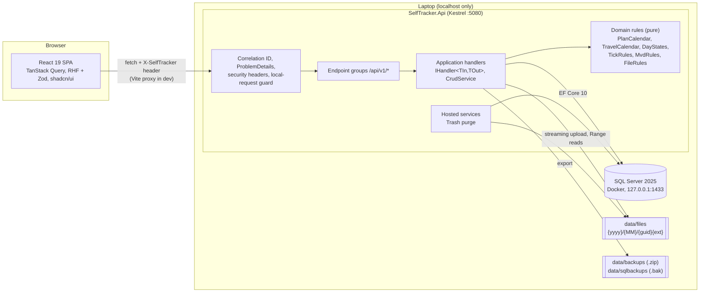

# Architecture

Single-user, local-first web app. One ASP.NET Core process (Minimal APIs) serves the API and, in local "prod", the built React SPA. SQL Server runs in Docker; files live on local disk. No cloud, telemetry or outbound calls.

## Projects (dependencies point inward)

| Project | Contents |
|---|---|
| `SelfTracker.Domain` | Entities, enums, pure rule services (BR-01..BR-07, file rules). No EF, no I/O. |
| `SelfTracker.Application` | `IAppDbContext`, `IClock`, `IFileStorage`, DTOs, handlers per feature, `PlanContext` (settings + calendars per request), generic CRUD. |
| `SelfTracker.Infrastructure` | `AppDbContext` (soft-delete filters, rowversion, seed-modification tracking), migrations, `LocalFileStorage`, `Seeder`, `DataPorter` (backup zip), hosted services, DI. |
| `SelfTracker.Api` | Program, middleware, endpoint groups, OpenAPI + Scalar, health checks, static SPA hosting. |
| `web/` | React app. Typed client generated from `/openapi/v1.json` (`npm run gen:api`). |

## Key flows

- **Plan day**: `PlanContext` loads settings, pauses, phases and travel overrides once per request and builds a `PlanCalendar` (BR-01..03) and `TravelCalendar` (BR-04). Everything plan-related (Today, heatmap, checkpoints later) derives from them; nothing derived is stored.
- **Daily log**: one row per date (filtered unique index). Core/Build ticks are rows validated by `TickRules` (BR-06); the DSA tick is computed. Time entries belong to a date and its log; derived entries (BR-19) will be owned by their source records.
- **Files**: upload streams each multipart section to `FileRoot/.tmp` while hashing (SHA-256), sniffs the type from bytes, rejects blocked extensions, detects duplicates by hash, moves the file into `{yyyy}/{MM}/{guid}{ext}`, then inserts the row (and link) — deleting the file if the insert fails. Soft delete moves nothing; purge removes the row, links and the physical file. Content is served with HTTP Range support.
- **Seeding**: idempotent by `SeedKey`; never overwrites user-modified rows (BR-15).
- **Soft delete and Trash**: global query filter on `IsDeleted`; Trash lists, restores and purges by entity type through `EntityRegistry`.
